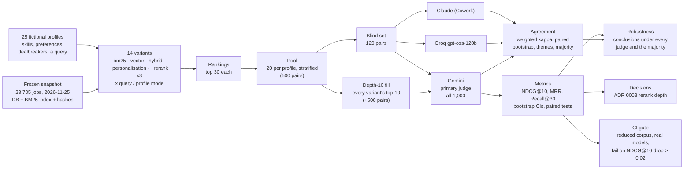

# How JobMatch's search is evaluated (one page)

**The question:** what does each stage of the search pipeline (keyword, vector, hybrid
fusion, personalisation, cross-encoder rerank) buy in ranking quality, and is it worth
its latency? Full report: [eval/report.md](../eval/report.md).

**Design choices, and why**

- **Frozen snapshot:** the pool changes daily, so every number must be reproducible from
  one restorable database and a hash manifest.
- **Fictional profiles:** no real person's data. They are written so the right answer is
  arguable but not arbitrary (dealbreakers, seniority, location).
- **Pooling plus a depth-10 fill:** the judged set is what the systems actually show.
  Filling every variant's top 10 means NDCG@10 makes no guess about unjudged jobs.
- **LLM judges, three model families:** hand-labelling 1,000 pairs was out of scope, so
  three different model families grade with one rubric. A conclusion is reported only
  with whether it holds under all of them.
- **Hash-identical inputs:** every grade stores a sha256 of exactly what the judge read,
  and only grades from identical input are compared. This is how a truncation problem
  was caught, measured with a controlled check and noise checks, and fixed (input v3).
- **Paired statistics:** profiles are the unit. Differences between variants (and between
  kappas before and after a fix) are paired bootstraps, because unpaired CIs over 25
  profiles always overlap.
- **A CI gate:** a committed reduced corpus lets CI re-run real search with the real
  models in under a minute and fail on a quality regression.

**What I'd do with a budget**

- **Human relevance labels:** two people grading the 120 blind pairs (then more),
  measuring human-human agreement first and then human-LLM agreement. That would turn
  "LLM-judged" into "LLM-judged, validated against people", and calibrate the rubric.
- **More and real-er profiles:** 100+ profiles drawn from consenting users' anonymised
  resumes and searches. That narrows the CIs and covers seekers the 25 don't represent.
- **Online signals:** clicks, saves and applications from real use, as an A/B check on
  what offline NDCG predicts.
- **Fuller judging:** deeper pools (top 30) for recall, full postings instead of a
  3,200-character section-aware trim, and the remaining ablations (freshness,
  source quality, gig/agency down-ranking, warm vs cold personalisation).
- **Faster rerankers:** the int8 and TinyBERT options for a sub-300 ms interactive rerank.
